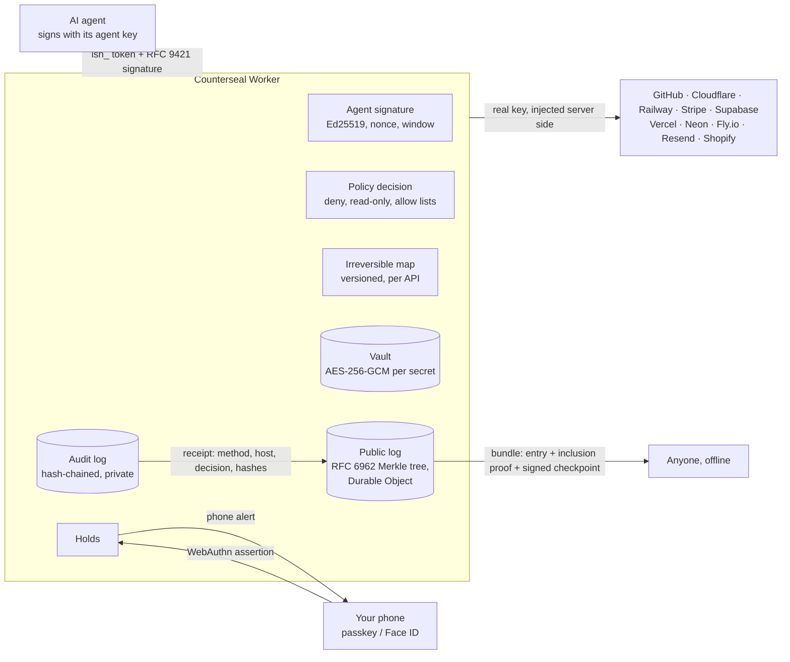
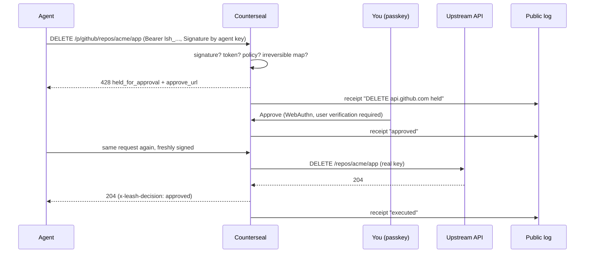

<div align="center">

# COUNTERSEAL

### Every irreversible action gets a second seal.

**The approval and proof layer for AI agents.** Your agent gets scoped proxy tokens instead of your real API keys.
Anything it can't take back (deleting a database, force pushing `main`, refunding customers, `DROP TABLE`) waits until a
human approves it with a passkey. Every decision becomes a receipt in a public log anyone can verify, and each agent can
sign its own requests, so a stolen token alone is useless.

The agent's signed request is the seal. Your passkey approval is the counterseal. The public log keeps the impression.

[Website](https://counterseal.gautamkhosla.com) · [Quickstart](#quickstart) · [How it works](#how-it-works) · [Security](SECURITY.md) · [Threat model](docs/THREAT_MODEL.md) · [Protocol](docs/PROTOCOL.md) · [Policy reference](docs/POLICY.md)

</div>

---

## Why this exists

In **late April 2026**, an AI coding agent working on a staging credential mismatch searched a repo, found a Railway API token in
an unrelated file, and called `volumeDelete`. PocketOS lost its production database **and every volume backup in nine
seconds**. The token had been created to manage custom domains. Its prompt-level guardrails were switched on.
([AI Incident Database](https://incidentdatabase.ai/reports/7311), [PointGuard AI](https://pointguardai.com/ai-security-incidents/ai-agent-deletes-production-database-in-nine-seconds-and-apologizes))

Prompts are not a permission system. Counterseal moves the decision out of the model, and keeps the proof:

| Without Counterseal | With Counterseal |
|---|---|
| Real keys sit in `.env` files the agent can read | The agent only ever holds `lsh_` proxy tokens |
| An over-scoped token can do anything its owner can | Each token is narrowed by a policy (paths, methods, read-only, rate) |
| Destructive calls happen at machine speed | Irreversible calls are held until you tap approve |
| A leaked token works for whoever finds it | A token bound to an agent key only works on requests that key signed |
| "What did the agent do?" is a guess, in logs you can edit | Every decision is in your hash-chained audit log and, as a receipt, in a public Merkle log |

## How it works

Three verbs, one service:

1. **Approve.** Irreversible calls are held until a passkey approves them, on your phone or laptop.
2. **Record.** Every allow, hold, approval and denial the broker makes on a write becomes a receipt in a public,
   append-only transparency log (RFC 6962, C2SP signed checkpoints). *If it was recorded, you can prove it.* Agents can
   log their own actions there too.
3. **Prove who.** An agent signs its requests with its own Ed25519 key (RFC 9421 HTTP Message Signatures). The receipt
   records that a registered agent key made the call.



What happens to one request:



### The rules

1. **The agent never holds a real key.** Keys are encrypted in the vault (a separate AES-256-GCM key per secret, wrapped by
   a master key; ciphertexts are bound to their row with AAD). No API returns a key.
2. **Irreversible means held.** The [irreversible map](server/src/providers.js) lists the calls on each API that can't be
   undone, each with the reason. Approval needs a fresh passkey ceremony and covers the exact same request (method, host,
   path, query, content type, body) once, within 10 minutes.
3. **Everything is on the record.** Every write, hold, approval and denial is appended to a per-account audit log where
   each entry hashes the previous one. With receipts on (the default for new accounts), each decision is also sealed in
   the public log: the method and provider host, the decision, the rule and the hash of the audit entry. Never a path,
   body, key, token, name, email or IP address.
4. **A bound token needs its agent.** A token bound to an agent key is refused unless the request is signed with that key
   (method, full URL, body digest and content type covered; 5 minute window; each nonce once).

### The one dangerous switch

A token can carry `unattendedIrreversible` rules for calls an agent may run unattended, **but only a passkey holder can mint
such a token**. A CLI session cannot, because an agent running on the same laptop can read the CLI's config file. The same
goes for approving holds (a coding agent's commands and a deploy gate's jobs included), making a deploy gate, revoking agent keys and turning public receipts off, and for everything that loosens a brake
(below): setting money caps, resetting a tripped breaker and unfreezing. Stopping things never needs a passkey. On a team
that requires two seals, nobody can flip this switch alone: pre-approvals and money caps are paused until the quorum is
lowered again, which takes 24 hours and tells everyone.

### Brakes

Three ways to keep an agent small. They apply to calls that go through Counterseal (Stripe refunds and payouts, and writes in
general). They do not cap LLM tokens, and they do not cover SQL sent straight over a database connection.

- **Money caps.** A token made with your passkey can carry `"money": {"currency": "usd", "perCall": 5000, "perDay": 20000}`
  (whole numbers of the currency's smallest unit: 50.00 and 200.00 USD). A Stripe refund or payout under both caps passes
  without asking. Above them, your phone asks for a passkey, with the amount in large type. Only `POST /v1/refunds` and
  `POST /v1/payouts` can pass, in that one currency, as a plain form that reads one way: a repeated, escaped or
  ambiguous amount, a query string, a JSON body or an unfamiliar currency spelling is held, and so is every other money
  call (transfers, charges, top-ups, confirms). A refund without an amount means everything left on the charge, which
  Counterseal asks Stripe about with your key. The day is the UTC calendar day, and calls you approve are yours: they are
  not counted. The rest of the token's policy still applies (an allow list or a hold rule that leaves the refund out keeps
  it held).
- **Breaker.** `"limits": {"writesPerHour": 200, "repeatsPer5Min": 3}`, which any session may set. A write is any request that
  is not a GET or HEAD. Past a limit the token trips: its writes wait until a passkey resets it, reads still pass, and
  your devices are told once. `repeatsPer5Min: 3` trips on the fourth identical request (same method, path, query, content
  type and body) within 5 minutes.
- **Freeze.** One tap in the app, `leashcli freeze`, or the Freeze button on a phone alert stops every agent token
  (HTTP 423), every coding-agent approval and every deploy gate, voids approvals nobody used yet and pauses approving. Any signed-in session can freeze; only a passkey in the
  app unfreezes.

A token without `limits` and `money` costs no extra database writes. See the [policy reference](docs/POLICY.md).

### Two-person seal (teams)

The counterseal in the literal sense: a second, different person seals what the first one approved. In this repo on
branch `feat/two-person`, not yet deployed (migration 0009; break glass and channels: migration 0011).

- **People, not shared logins.** An owner invites people with a link that works once (2 hours by default, 24 at most);
  each person makes their own passkey and signs in as themselves. Roles: **owner** (the team, the quorum, the vault),
  **approver** (seals held actions), **member** (makes tokens and keys for their agents, cannot seal), **viewer** (reads,
  can deny). Roles are checked on the server for every request.
- **Two seals.** With the quorum at 2, a held API call or coding-agent command goes ahead only when two different owners
  or approvers have each approved it with their own passkey. One person counts once, with any number of passkeys or
  browsers. You can also require that the person whose token or guard key asked is not one of them. Anyone can deny:
  one no ends it.
- **Never lowered quietly.** Raising the quorum takes effect at once. Lowering it, or letting the person who asked count,
  takes 24 hours, wakes every member's devices, and any approver can cancel it. While one person cannot approve alone, a new
  approver's seal counts 24 hours after they join, and pre-approvals and money caps are paused: no one person can
  approve in advance.
- **Leaving is instant.** Removing someone signs them out everywhere, deletes their passkeys and alert devices, revokes
  the tokens and keys they made, drops their seals and voids approvals they helped give that are not yet used, in one
  step. The last owner can never be removed. Only its maker or an owner can revoke someone's token or key.
- **Public receipts** of an approval record how many seals were required and given, never who.
- **Break glass.** For the night the second approver cannot be reached: an owner or approver opens a window of 5 to 60
  minutes with a passkey. What Counterseal would hold, for the tokens and guard keys you pick, goes through; every call is on
  the record (and its public receipt says `breakglass`), every member and channel is told at once, any member can close it,
  and it cannot be extended (three a day). It never lifts a freeze, a tripped breaker or a money cap, and not a deploy gate.
- **Slack, Discord and Google Chat** are told when something is held, part-sealed, or the team changes (who asked, the rule,
  how many seals, a link; never the path, command, body, amount or a name). They cannot approve: only a passkey in the app does.
  The webhook address is kept encrypted and never shown again.

What it does not do: stop two people who agree to act together. See [threat model T1 to T13](docs/THREAT_MODEL.md) and the
[team API](docs/PROTOCOL.md#team-the-two-person-seal).

## Quickstart

```bash
npx leashcli login                      # type its code at /app#device, check where it started, approve with your passkey
npx leashcli add github                 # paste the key once; it goes into the vault, never onto disk
npx leashcli creds                      # note the credential id
npx leashcli token <credentialId> --label "coding agent, laptop"
```

The CLI package keeps its first name, `leashcli`; it is the same service. A CLI sign-in lasts 7 days, and tokens and receipts
keys it makes end with it. The code is typed in the app, never sent as a link: never type a code someone sent you, because whoever
approves a code gives that command line their account. Each sign-in alerts your devices and can be revoked in the app
(Account), with every token and key it made.

**Two hosts.** The product lives at counterseal.gautamkhosla.com. The old host, leash.gautamkhosla.com, keeps serving
the API and the proxy exactly as before (so leashcli 0.1.1 and configured agents keep working) and its `/app` sign-in for
passkeys made there; its other pages redirect to counterseal. An account made on the old host moves with a one-time
link (Account, "Move with passkey") that adds a counterseal passkey to the same account. See docs/DEPLOY.md.

### Connect your agent (MCP)

```json
{
  "mcpServers": {
    "leash": {
      "command": "npx",
      "args": ["-y", "leashcli", "mcp"],
      "env": { "LEASH_TOKENS": "github=lsh_..." }
    }
  }
}
```

The `leash_request` tool lets the agent call any configured API. When a call is held, the tool result tells the agent to
stop, give you the approve link, and retry the identical call after you approve. APIs that take a form instead of JSON
(Stripe) use the tool's `form` field; `leashcli mcp` sends it as `application/x-www-form-urlencoded`.

### Give the agent its own key (Prove who)

Make an agent key in the app (generated in your browser; only the public half is sent), or with CLI 0.2.1 from the
agent's machine, then bind a token to it and give the MCP server the key file:

```bash
npx leashcli agent-key agent-key.json --label laptop-agent     # CLI 0.2.1 (in this repo, not yet published)
npx leashcli token <credentialId> --agent-key <agentKeyId>
# MCP env: { "LEASH_TOKENS": "github=lsh_...", "LEASH_AGENT_KEY": "/path/to/agent-key.json" }
```

Signing from the MCP server needs CLI 0.2.1 too: `npx leashcli` still runs 0.1.1 from npm, which cannot sign, so a
bound token would refuse its calls. Until 0.2.1 is published, run `cli/leash.mjs` from this repository.

### Approvals for what Counterseal does not proxy (a coding agent's commands)

Some irreversible actions never pass through an API Counterseal brokers: `terraform destroy`, `railway volume delete`,
`gh repo delete`, `prisma migrate reset`, `DROP TABLE` through `psql`, `git push --force`. For those, a hook on the
agent's machine (`leashcli guard`, in the next section) holds a **guard key** (`lsg_`) and asks the Approvals API:

```bash
# ask (Bearer lsg_): the exact command, why it is held, and the folder it runs in
curl -s -X POST https://counterseal.gautamkhosla.com/v1/approvals -H "authorization: Bearer $LSG" -H 'content-type: application/json' \
  -d '{"kind":"shell","agent":"claude-code","rule":"sh.terraform-destroy","why":"Destroys every resource in the state.","summary":"terraform destroy","detail":"terraform destroy -auto-approve","context":{"cwd":"infra"}}'
# -> 202 {"id","status":"pending","hash","approve_url","expires_at"}; your phone buzzes; approve in the app with your passkey
curl -s "https://counterseal.gautamkhosla.com/v1/approvals/$ID?wait=20" -H "authorization: Bearer $LSG"   # long-poll, writes nothing
curl -s -X POST "https://counterseal.gautamkhosla.com/v1/approvals/$ID/use" -H "authorization: Bearer $LSG" -H 'content-type: application/json' -d "{\"hash\":\"$HASH\"}"
```

- An approval covers that exact command (with its agent and folder), once, within 10 minutes. You can deny with a reason;
  the agent gets the reason back.
- A guard key can ask and read its own approvals; it can never approve (that always needs your passkey in the app). Make
  one in the app (Account, Guard keys) or from a signed-in `leashcli`; a key made by a CLI sign-in ends with it.
- **The guard runs on the agent's machine: a seatbelt, not a sandbox.** An agent that can edit its hook settings or run a
  script around the hook is not stopped by it. For a hard stop, give the agent a Counterseal token instead of the real key.
- Public receipts say only `RUN claude-code` (or `CALL mcp`), the decision, the rule id and the map version; never the
  command, folder or label.

The full contract (request fields, errors, budgets) is in [docs/PROTOCOL.md](docs/PROTOCOL.md#approvals-for-what-the-broker-does-not-proxy).

### Guard your coding agent (`leashcli guard`)

`leashcli guard` is the hook that does the asking for you. It reads each shell command your coding agent is about to
run the way a shell does (quotes, `&&` and pipes, `sh -c`, `sudo`, `xargs`, `ssh`, `docker exec`, `package.json` scripts and
more) and holds the ones on the **shell map** (version `2026-10-10.1`, 27 rules: `terraform destroy`, `git push --force`,
`DROP TABLE` through `psql`, `railway volume delete`, `gh repo delete`, `rm -rf` outside the project, `kubectl delete`,
`docker volume prune`, cloud CLI deletes, `curl` to a brokered API with a write method, and more) until you approve that
exact command, once, with a passkey. Everything not on the map is left to the agent's own permission settings.

It needs CLI 0.2.1, which is in this repository and not on npm yet; until it is, run `node cli/leash.mjs guard ...` from a
clone instead of `npx leashcli guard ...`.

```bash
npx leashcli login                                  # a guard key made through this ends with the sign-in (7 days at most)
npx leashcli guard install                          # finds Claude Code, Codex and Cursor; or --agents claude-code,codex,cursor
npx leashcli guard check -- terraform destroy       # what the map says about a command, offline
npx leashcli guard status                           # what is installed, whether the key works, whether the account is frozen
npx leashcli guard uninstall                        # removes only its own hooks, revokes the key
```

`install` makes a guard key, saves it in `~/.config/leash/guard.json` (mode 600, never printed), copies the guard next to
it, and adds hook entries to `~/.claude/settings.json`, `~/.codex/hooks.json` and `~/.cursor/hooks.json` without touching
anything else (it saves a backup, shows the diff, and `--dry-run` shows it without writing). For a key that lasts, make one
in the app (Account, Guard keys) and run `npx leashcli guard install --paste-key`.

**Claude Code plugin** (the same hook, from this repository's marketplace file, no form):

```bash
claude plugin marketplace add GautamTalksDev/leash
claude plugin install counterseal@counterseal
npx leashcli guard install --agents none            # makes the key the plugin's hook uses
```

The plugin runs its own pinned copy of the guard (never `npx` at hook time) and needs `node` on your PATH. Claude Code
2.1.295 or later blocks the command when the hook crashes or times out; older versions let it through. With the plugin
switched on, `guard install` adds no second hook to Claude Code.

- **A held command waits for you.** The agent's tool call pauses for up to 9 minutes while your phone shows the exact
  command; approve and it runs, deny (with a reason) and the agent is told, with your words quoted as text. Agents whose
  hooks cannot wait (or `"mode": "retry"`) get the answer at once with the link and run the same command again after you
  approve. On a team that requires two seals, the command stays pending until two different people have approved it:
  the hook keeps waiting, prints "1 of 2 approvals so far", and tells the agent that a second person has to approve it
  if the time runs out. Only the person who made a guard key, or an owner, can revoke it.
- **Fail closed.** If the server cannot be reached, the key is no longer valid, you are rate limited, or the account is
  frozen, a command on the map is denied with the reason and the fix; every other command runs as before. Set
  `"onUnavailable": "allow"` in `guard.json` to let commands through when the server cannot be reached (a revoked key, a
  rate limit and a freeze still deny). A request times out after 10 seconds.
- **What leaves your machine.** The command with credentials removed (connection strings, bearer tokens, key-shaped
  values, `PASSWORD=` style variables), the rule, why, the name of the folder (not its path) and the session id. Held
  commands are shown on your devices and may appear on the lock screen.
- **What it does not see.** Aliases and functions defined outside the command line; the contents of script files and
  Makefiles; code in other languages (`python -c`, `node -e`); PowerShell and `cmd`; encoded payloads (a decoder piped
  into a shell is held, not read); globs; symlinks. An agent that edits its own hook settings, the guard's files or its
  config, or runs the same effect through a script, is not stopped: **a seatbelt, not a sandbox**. For a hard stop, give
  the agent a Counterseal token instead of the real key.
- **How far each agent is tested.** The hook is tested against the real Approvals API code over HTTP
  (`cli/test/guard-server.test.mjs`) and against each agent's documented hook format. Claude Code: the plugin passes
  `claude plugin validate --strict` and installs from the marketplace file with Claude Code 2.1.293; it has not been seen
  firing in a live session. Codex and Cursor: written to their documented formats, not tested in the apps. Copilot CLI,
  Gemini CLI and Antigravity are not supported yet.

The shell map (`sdk/shellmap.mjs`, tests in `sdk/shellmap.test.mjs` with about a thousand commands in
`sdk/shellmap.vectors.txt`, and `sdk/shellmap.bash.test.mjs`, which compares it with real bash on generated commands: the words
a command comes to, and whether a stub `terraform destroy` really runs where the map says "not held") is documented rule by rule in the [docs](https://counterseal.gautamkhosla.com/docs/#guard-cli).

### Deploy Gate for GitHub Actions

Hold any GitHub Actions job until you approve it with a passkey. GitHub's own deployment approvals (required reviewers, wait
timers, custom protection rules) are available only for public repositories on the Free, Pro and Team plans, GitHub's
documentation says ([read 9 Oct 2026](https://docs.github.com/en/actions/reference/workflows-and-actions/deployments-and-environments)).
A gate does not use them: the job's step sends the OIDC token GitHub signs for it, Counterseal verifies it, and your phone shows
the repository, workflow, commit, run and who started it, from that token. In this repo, not yet deployed (migration 0007); the
action is in [`action/deploy-gate`](action/deploy-gate) and is not on the Marketplace.

1. In the app, Deploy gates, **New gate** (it asks for your passkey): the repository, its workflow files and the branches or
   tags it deploys from. Nothing is accepted by default.
2. Copy `action/deploy-gate` to `.github/actions/counterseal-gate` in the repository and add the step to a job that has
   `permissions: id-token: write`:

```yaml
jobs:
  approve:
    runs-on: ubuntu-latest
    permissions:
      id-token: write   # lets the job ask GitHub for the token the gate checks
      contents: read
    steps:
      - uses: ./.github/actions/counterseal-gate
        with:
          gate: gate_0123456789abcdef01234567      # from the app; not a secret
          summary: deploy ${{ github.sha }} to production
          timeout-minutes: 15
```

3. Run the workflow. The step prints a link and waits; approve with your passkey and the job goes on. It fails if you deny, if
   nobody decides in time, or if the run is not what the gate accepts. More samples (a deploy job after the gate, and a gate
   that hands the job a 15 minute token for a vaulted key only after you approve, so there is no deploy key in the repository
   before then) are in [`action/deploy-gate/examples`](action/deploy-gate/examples).

- The approval covers one run: GitHub's repository and owner ids, run, attempt, commit, workflow, ref and environment. The
  first approved run binds the gate to the repository's ids, so a repository that is deleted and re-created under the same name
  cannot use it.
- **A gate is a pause the job asks for.** A person who can edit the workflow file can remove the step: protect the file, or use
  the key option above, where the job has nothing to deploy with before an approval.
- On a team that requires two seals, a deploy needs two different approvers (and with self-approval off, not the person who made the gate); removing the gate's maker stops it. See "On a team" in docs/DEPLOY_GATE.md.
- Waiting writes nothing to the database. A job that waits uses Actions minutes (private repositories), so keep the timeout low.
- Public receipts say `DEPLOY github.com`, the decision and the rule; never the repository unless you opt in for that gate.
- Not yet run against real GitHub tokens: the tests use a stand-in that signs like GitHub. The first real run is the real test.

Usage, what is checked, limits and errors: [docs/DEPLOY_GATE.md](docs/DEPLOY_GATE.md). The contract is in
[docs/PROTOCOL.md](docs/PROTOCOL.md#deploy-gates).

### Any SDK or script

| Provider | Base URL |
|---|---|
| GitHub | `https://counterseal.gautamkhosla.com/p/github` |
| Cloudflare | `https://counterseal.gautamkhosla.com/p/cloudflare` (paths after `/client/v4`) |
| Railway | `https://counterseal.gautamkhosla.com/p/railway/` (GraphQL) |
| Stripe | `https://counterseal.gautamkhosla.com/p/stripe` |
| Supabase (management API) | `https://counterseal.gautamkhosla.com/p/supabase` |
| Vercel | `https://counterseal.gautamkhosla.com/p/vercel` |
| Neon | `https://counterseal.gautamkhosla.com/p/neon` (paths after `/api/v2`) |
| Fly.io (Machines API) | `https://counterseal.gautamkhosla.com/p/fly` (paths after `/v1`; vault the whole token line `fly tokens create` prints, `FlyV1 fm2_...`) |
| Resend | `https://counterseal.gautamkhosla.com/p/resend` |
| Shopify (Admin GraphQL API only) | `https://counterseal.gautamkhosla.com/p/shopify/admin/api/2026-07/graphql.json`; add the key with its store address: `leashcli add shopify --host your-store.myshopify.com` |

The irreversible map covers 10 APIs: GitHub, Cloudflare, Railway, Stripe, Supabase, Vercel, Neon, Fly.io, Resend and Shopify. Management APIs only; SQL sent straight over a database connection string never passes through Counterseal. The map version is `2026-10-10.1`; every rule has its reason and the reference page it comes from in [server/src/providers.js](server/src/providers.js).

### Verify a receipt

Download a bundle from the app (Receipts) and check it at [/verify/](https://counterseal.gautamkhosla.com/verify/), or offline:

```bash
node sdk/receipts.mjs verify receipt-42.json --key "$(curl -s https://counterseal.gautamkhosla.com/v1/log/key | jq -r .verifier_key)"
```

Pin the verifier key once and keep it with your auditors; a bundle's own `log` field is only a hint.

### Free tool: Web Bot Auth checker

[/tools/web-bot-auth/](https://counterseal.gautamkhosla.com/tools/web-bot-auth/) checks a Web Bot Auth signature (RFC 9421) from
any AI agent, in your browser. The same code is in `sdk/websig.mjs` and `sdk/verifier.mjs` for your own server.

## Limits (Workers Free)

Receipts: 10,000 per account per month, 2,000 per account per UTC day, 10,000 appends per UTC day for the whole log;
batches of 25 (12 signed). When a limit is reached the broker still decides and still writes the audit log; the receipt is
skipped and counted. See [docs/DEPLOY.md](docs/DEPLOY.md) for every daily budget.

## Repository layout

```
server/        Cloudflare Worker: API, proxy, vault, WebAuthn, policy, audit, the public log (Durable Object), agent keys
  src/brand.js       every product name, domain and tagline (run scripts/rebrand.mjs after changing it)
  src/providers.js   the irreversible map (versioned; every rule has a test)
  src/ledger.js      receipts: the public log API, the receipts API, broker receipts
  src/agentkeys.js   agent keys: proof of possession, RFC 9421 broker signatures
  src/approvals.js   the Approvals API and guard keys: approvals for a coding agent's commands and tool calls
  src/brakes.js      money caps, the breaker and Freeze (src/money.js: how amounts are read and shown)
  src/team.js        the two-person seal: members, invites, roles, the quorum and seals
  src/gates.js       Deploy Gate: gates, a job's request, the poll, phase 2 (src/oidc.js verifies GitHub's token; src/gatefacts.js)
  test/              node:test suite: virtual passkeys, fake upstream, migration on data from the live code
  bench/cpu.mjs      CPU of the hot paths
  dev/local.js       full local server on node:sqlite
action/        GitHub Action (deploy-gate, zero dependencies) and sample workflows; not on the Marketplace
cli/           leash CLI and MCP server (zero dependencies), sign.mjs for agent keys, guard.mjs (the coding-agent guard)
  test/              the guard against a stand-in and against the real server code over HTTP; the plugin files
sdk/           receipts (record + verify offline), websig (Web Bot Auth sign + verify) and shellmap (the shell map), zero dependencies
plugins/       the Claude Code plugin (hook, skill, pinned scripts); .claude-plugin/marketplace.json at the root lists it
scripts/       rebrand.mjs, sync-guard.mjs (keeps the guard copies, the SQL block and the API map in step with the server)
site/public/   website and dashboard (strict CSP, Trusted Types, no third-party code)
docs/          threat model, protocol, policy reference, deployment
```

## Develop

```bash
cd server
node --test test/*.test.js ../sdk/*.test.mjs ../cli/test/*.test.mjs   # the whole suite
node ../scripts/sync-guard.mjs                  # after changing the shell map, the CLI or the server map: rewrite the generated copies
node bench/cpu.mjs                              # CPU per hot path
node dev/local.js 8790                          # http://localhost:8790 (passkeys work on localhost)
```

## Deploy

See [docs/DEPLOY.md](docs/DEPLOY.md): one new secret (`LOG_KEY_JWK`), eight additive migrations (0004 to 0011), `wrangler deploy`.

## Status and roadmap

Brokers GitHub, Cloudflare, Railway, Stripe, Supabase, Vercel, Neon, Fly.io, Resend and Shopify; phone and desktop alerts for held calls (Web Push,
payload-free); public receipts; agent keys; money caps, a breaker and Freeze. In this repo, not yet deployed: the Approvals API and guard keys for a
coding agent's commands, `leashcli guard` with its shell map and Claude Code plugin (CLI 0.2.1, not yet on npm), the two-person seal (team members,
invites, roles, quorum votes) with break-glass windows and Slack, Discord and Google Chat alerts, and the Deploy Gate for GitHub Actions. Next: AWS (SigV4
re-signing), PlanetScale; SSO for teams; external witness cosigning of checkpoints (C2SP tlog-witness); SCITT-compatible receipts.

Counterseal maps to the proxy-gateway model of the IETF draft
[Credential Broker for Agents (CB4A)](https://www.ietf.org/archive/id/draft-hartman-credential-broker-4-agents-00.html)
(-00, an individual draft): scoped credentials that only work through the broker, policy decisions outside the agent,
and approval for the calls that matter.

## License

Apache-2.0. See [LICENSE](LICENSE).
