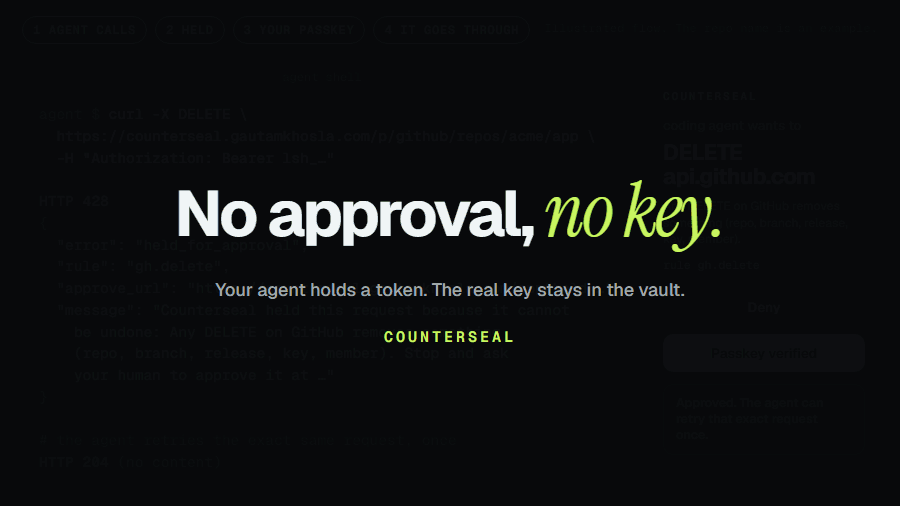
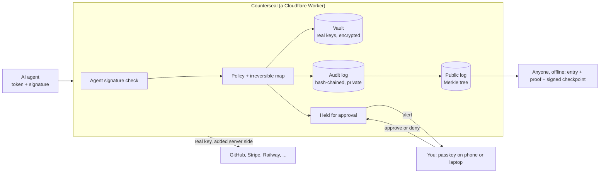
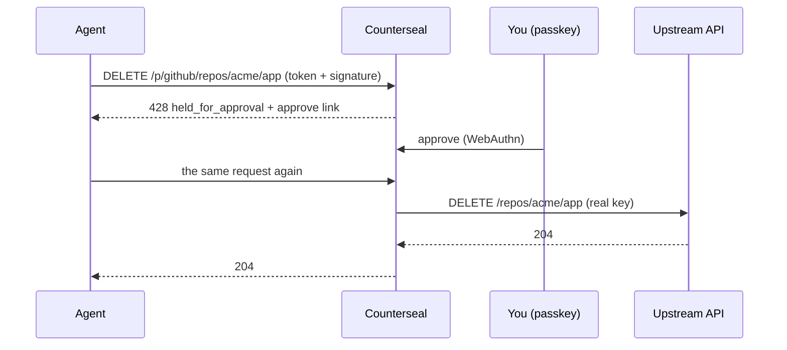

<div align="center">

# COUNTERSEAL

### Every irreversible action gets a second seal.

**Your AI agent never holds a real API key, and anything it cannot take back waits for your passkey.**

[Website](https://counterseal.gautamkhosla.com) · [Quickstart](#quickstart) · [How it works](#how-it-works) · [Limits](#honest-limits) · [Security](SECURITY.md) · [Self-hosting](docs/DEPLOY.md) · [Full guide](docs/GUIDE.md)

[](https://github.com/GautamTalksDev/counterseal/actions/workflows/ci.yml) [](https://github.com/GautamTalksDev/counterseal/actions/workflows/codeql.yml) [](https://scorecard.dev/viewer/?uri=github.com/GautamTalksDev/counterseal) [](https://www.npmjs.com/package/counterseal) [](LICENSE)



<sub>Illustrated flow: the repository name is an example. The 428 response, the rule id and the approve link are what the server returns.</sub>

</div>

## Quickstart

Three commands (the CLI is the [`counterseal`](https://www.npmjs.com/package/counterseal) package, Node 20 or later, zero dependencies):

```bash
npx counterseal login                                    # prints a code; type it at /app#device, check where it started, approve with your passkey
npx counterseal add github                               # paste the key once; it goes into the vault
npx counterseal token --label "coding agent, laptop"     # a proxy token for the agent (with one key in the vault no id is needed)
```

Prefer no terminal? Create an account at [/app](https://counterseal.gautamkhosla.com/app) (a name and a passkey) and press
**Try a held call**: a pretend call you approve with your passkey (nothing real is called and nothing is made public).
Then [connect your agent](#connect-your-agent).

---

## Why: no approval, no key

In April 2026, an AI coding agent hunting for a staging credential found a Railway API token in an unrelated file and
called `volumeDelete`. PocketOS had its production database and the backups on the same volume deleted in nine seconds.
The token had been made to manage custom domains, and the prompt-level guardrails were on.
([AI Incident Database](https://incidentdatabase.ai/reports/7311))

A prompt is not a permission system. Counterseal moves the decision out of the model:

- The agent holds a scoped proxy token (`lsh_...`), never the real key. The real key stays in an encrypted vault and is
  added to the request on the server.
- A call that cannot be undone (a delete, a force push, a refund, a `DROP TABLE`) is held until a human approves that
  exact request with a passkey. No approval, no key.
- The decision is written down. With receipts on, each decision on a write is also an entry in a public log that anyone
  can check.

The agent's signed request is the seal. Your passkey approval is the counterseal. The public log keeps the impression.

## Connect your agent

After the three commands in the [quickstart](#quickstart), give the token to your agent as an MCP server (the `leash_request` tool calls the APIs through Counterseal):

```json
{
  "mcpServers": {
    "counterseal": {
      "command": "npx",
      "args": ["-y", "counterseal", "mcp"],
      "env": { "LEASH_TOKENS": "github=lsh_..." }
    }
  }
}
```

Or point any SDK at `https://counterseal.gautamkhosla.com/p/github` with the token as its bearer. When the agent tries
something irreversible it gets `428 held_for_approval` and an approve link, and your phone or browser asks for a passkey.

All commands: `login`, `logout`, `add`, `creds`, `tokens`, `token`, `revoke`, `freeze`, `holds`, `watch`, `agent-key`, `agent-keys`, `mcp`, `mcp wrap`, `mcp pin`, `mcp unpin`, `mcp status`, `guard install`, `guard uninstall`, `guard status`, `guard check`, `guard map`. See the [CLI reference](docs/GUIDE.md#cli-reference) for arguments, flags, and descriptions. Run `npx counterseal help`.

## Features

| | What it does |
|---|---|
| **Approve** | Irreversible calls are held until a passkey approves them, on your phone or laptop. An approval covers that exact request, once, within 10 minutes. |
| **Record** | With receipts on, every decision the broker makes on a write (allowed, held, approved, executed, denied) becomes an entry in a public, append-only Merkle log (RFC 6962, signed checkpoints). Allowed reads are not recorded. A receipt holds the method, the provider host, the decision and the rule, never a path, body, key, token, name, email or IP. Verify in the browser or offline with `sdk/receipts.mjs`. |
| **Prove who** | Bind a token to an agent key (Ed25519). It then only works on requests that key signed (RFC 9421), so a stolen token alone does nothing. |
| **Guard** | `counterseal guard` is a hook for a coding agent's shell commands. A command on the shell map (29 rules: `terraform destroy`, `git push --force`, `DROP TABLE` through `psql`, `rm -rf` outside the project, and more) waits for your passkey. A seatbelt, not a sandbox. |
| **MCP gateway** | `counterseal mcp wrap` sits in front of any local MCP server: destructive tool calls wait for your passkey, and the server's tool definitions are pinned so a changed tool is hidden until you review it. |
| **Two-person seal** | A team can require two different people, each with their own passkey, before an irreversible action goes ahead. Roles, one-time invites, and nobody can lower the rule quietly: lowering it takes 24 hours and tells everyone. |
| **Deploy Gate (preview)** | A GitHub Actions step that holds a deploy job until you approve that exact run. It uses the OIDC token GitHub signs for the job. Not yet tested with real GitHub tokens, only with a stand-in that signs like GitHub, so it is not part of the launch. The action is in this repository, not on the Marketplace. |
| **Brakes** | Money caps for Stripe refunds and payouts, a breaker for too many or repeated writes, and Freeze, which stops every agent token at once. They cover calls through Counterseal, not LLM tokens. |
| **The app** | An installable web app with live holds, alerts to your devices that carry no payload, the audit log, a privacy center, a data export and an evidence pack. |

The irreversible map covers 10 APIs: GitHub, Cloudflare, Railway, Stripe, Supabase, Vercel, Neon, Fly.io, Resend and Shopify. Management APIs only; SQL sent straight over a database connection string never passes through Counterseal.

Details for each are in the [full guide](docs/GUIDE.md) and the [policy reference](docs/POLICY.md).

## How it works



One request, end to end:



## Honest limits

- **It is a broker, not a sandbox.** It protects calls that go through it. An agent that still has the real key in a `.env`
  file can bypass it, so put the real key in the vault and give the agent a Counterseal token.
- **The guard and the MCP wrapper are seatbelts.** They run on the agent's machine as the same user. An agent that can edit
  its own hook settings or run a script around the hook is not stopped. They match lists; they do not understand intent.
  For a hard stop, give the agent a token instead of the real key.
- **The map is a reviewed list, not every dangerous action.** Everything not on it is allowed on those hosts.
- **The public log has one signing key.** Split views are detectable, not prevented. Cosigning by independent outside parties is on the roadmap.
- **Receipts prove what was decided**, that an agent key signed, and that a passkey approved. Publicly they do not say which
  person approved, and the time of each receipt is public.
- **Two people who agree to act together** are out of scope for the two-person seal. Break glass, by design, lets one person
  loosen protection for up to an hour.
- **The Deploy Gate has not run against real GitHub tokens yet**; the tests use a stand-in that signs like GitHub.
- **Brakes cover brokered calls only**, not LLM spend and not SQL over a database connection.
- **Not independently audited.** The [security standards page](https://counterseal.gautamkhosla.com/security/standards/) is a
  self-assessment. Beta limits are in [docs/DEPLOY.md](docs/DEPLOY.md).

## Security model

[SECURITY.md](SECURITY.md) (guarantees, controls, how to report a vulnerability) and the
[threat model](docs/THREAT_MODEL.md). The wire formats are in [docs/PROTOCOL.md](docs/PROTOCOL.md).

## Self-hosting

Counterseal is one Cloudflare Worker, one D1 database and one Durable Object, and it fits the Workers Free plan. Follow
[docs/DEPLOY.md](docs/DEPLOY.md) (secrets, migrations, `wrangler deploy`, settings). To work on it locally:

```bash
cd server
node --test test/*.test.js ../sdk/*.test.mjs ../cli/test/*.test.mjs   # the whole suite
node dev/local.js 8790                                                # a local server on http://localhost:8790
```

## Repository layout

```
server/        the Worker: API, proxy, vault, passkeys, policy, audit, the public log, approvals, teams, gates
cli/           the counterseal CLI, MCP server, guard and MCP wrapper (zero dependencies)
sdk/           receipts (record and verify offline), Web Bot Auth sign and verify, the shell map
action/        the Deploy Gate GitHub Action and sample workflows
plugins/       the coding-agent plugin (hook, skill, pinned scripts)
packages/      leashcli, the old package name, a thin alias for counterseal
site/public/   the website and the installable app
docs/          guide, threat model, protocol, policy reference, deployment, release checklist
```

## Contributing

Issues and pull requests are welcome. Read [CONTRIBUTING.md](CONTRIBUTING.md) and the
[Code of Conduct](CODE_OF_CONDUCT.md) first. Report a vulnerability privately, as [SECURITY.md](SECURITY.md) describes,
never in a public issue.

## Status

The CLI, `counterseal` 0.4.0, is on npm. The hosted service lives at
[counterseal.gautamkhosla.com](https://counterseal.gautamkhosla.com) and is free during the public beta; there is no
billing and no paid plan. What each release adds is in [CHANGELOG.md](CHANGELOG.md), and what is deployed where is in
[docs/DEPLOY.md](docs/DEPLOY.md). Self-hosting runs everything in this repository.

Next: AWS (SigV4 re-signing), PlanetScale, SSO for teams, outside cosigning of the log checkpoints, SCITT
receipts.

## License

[Apache-2.0](LICENSE).
