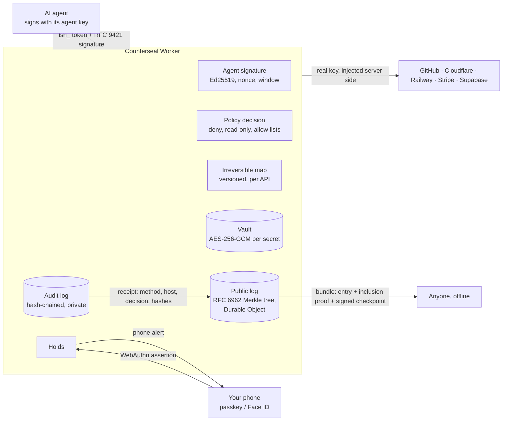
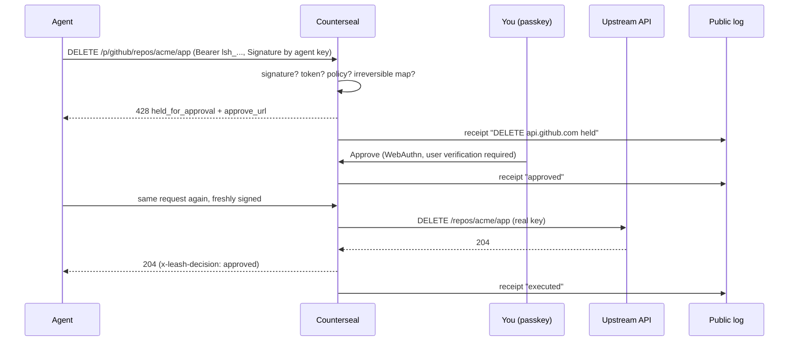

<div align="center">

# COUNTERSEAL

### Every irreversible action gets a second seal.

**The approval and proof layer for AI agents.** Your agent gets scoped proxy tokens instead of your real API keys.
Anything it can't take back (deleting a database, force pushing `main`, refunding customers, `DROP TABLE`) waits until a
human approves it with a passkey. Every decision becomes a receipt in a public log anyone can verify, and each agent can
sign its own requests, so a stolen token alone is useless.

The agent's signed request is the seal. Your passkey approval is the counterseal. The public log keeps the impression.

[Website](https://leash.gautamkhosla.com) · [Quickstart](#quickstart) · [How it works](#how-it-works) · [Security](SECURITY.md) · [Threat model](docs/THREAT_MODEL.md) · [Protocol](docs/PROTOCOL.md) · [Policy reference](docs/POLICY.md)

</div>

---

## Why this exists

In **late April 2026**, an AI coding agent working on a staging credential mismatch searched a repo, found a Railway API token in
an unrelated file, and called `volumeDelete`. PocketOS lost its production database **and every volume backup in nine
seconds**. The token had been created to manage custom domains. Every prompt-level guardrail was switched on.
([AI Incident Database](https://incidentdatabase.ai/reports/7311), [PointGuard AI](https://pointguardai.com/ai-security-incidents/ai-agent-deletes-production-database-in-nine-seconds-and-apologizes))

Prompts are not a permission system. Counterseal moves the decision out of the model, and keeps the proof:

| Without Counterseal | With Counterseal |
|---|---|
| Real keys sit in `.env` files the agent can read | The agent only ever holds `lsh_` proxy tokens |
| An over-scoped token can do anything its owner can | Each token is narrowed by a policy (paths, methods, read-only, rate) |
| Destructive calls happen at machine speed | Irreversible calls are held until you tap approve |
| A leaked token works for whoever finds it | A token bound to an agent key only works on requests that key signed |
| "What did the agent do?" is a guess, in logs you can edit | Every decision is in your hash-chained audit log and, as a receipt, in a public Merkle log |

## How it works

Three verbs, one service:

1. **Approve.** Irreversible calls are held until a passkey approves them, on your phone or laptop.
2. **Record.** Every allow, hold, approval and denial the broker makes on a write becomes a receipt in a public,
   append-only transparency log (RFC 6962, C2SP signed checkpoints). *If it was recorded, you can prove it.* Agents can
   log their own actions there too.
3. **Prove who.** An agent signs its requests with its own Ed25519 key (RFC 9421 HTTP Message Signatures). The receipt
   records that a registered agent key made the call.



What happens to one request:



### The rules

1. **The agent never holds a real key.** Keys are encrypted in the vault (a separate AES-256-GCM key per secret, wrapped by
   a master key; ciphertexts are bound to their row with AAD). No API returns a key.
2. **Irreversible means held.** The [irreversible map](server/src/providers.js) lists the calls on each API that can't be
   undone, each with the reason. Approval needs a fresh passkey ceremony and covers the exact same request (method, host,
   path, query, content type, body) once, within 10 minutes.
3. **Everything is on the record.** Every write, hold, approval and denial is appended to a per-account audit log where
   each entry hashes the previous one. With receipts on (the default for new accounts), each decision is also sealed in
   the public log: the method and provider host, the decision, the rule and the hash of the audit entry. Never a path,
   body, key, token, name, email or IP address.
4. **A bound token needs its agent.** A token bound to an agent key is refused unless the request is signed with that key
   (method, full URL, body digest and content type covered; 5 minute window; each nonce once).

### The one dangerous switch

A token can carry `unattendedIrreversible` rules for calls an agent may run unattended, **but only a passkey holder can mint
such a token**. A CLI session cannot, because an agent running on the same laptop can read the CLI's config file. The same
goes for approving holds, revoking agent keys and turning public receipts off.

## Quickstart

```bash
npx leashcli login                      # approve the code with your passkey in the browser
npx leashcli add github                 # paste the key once; it goes into the vault, never onto disk
npx leashcli creds                      # note the credential id
npx leashcli token <credentialId> --label "coding agent, laptop"
```

The CLI package keeps its first name, `leashcli`; it is the same service.

### Connect your agent (MCP)

```json
{
  "mcpServers": {
    "leash": {
      "command": "npx",
      "args": ["-y", "leashcli", "mcp"],
      "env": { "LEASH_TOKENS": "github=lsh_..." }
    }
  }
}
```

The `leash_request` tool lets the agent call any configured API. When a call is held, the tool result tells the agent to
stop, give you the approve link, and retry the identical call after you approve.

### Give the agent its own key (Prove who)

Make an agent key in the app (generated in your browser; only the public half is sent), or with CLI 0.2.0 from the
agent's machine, then bind a token to it and give the MCP server the key file:

```bash
npx leashcli agent-key agent-key.json --label laptop-agent     # CLI 0.2.0 (in this repo, not yet published)
npx leashcli token <credentialId> --agent-key <agentKeyId>
# MCP env: { "LEASH_TOKENS": "github=lsh_...", "LEASH_AGENT_KEY": "/path/to/agent-key.json" }
```

### Any SDK or script

| Provider | Base URL |
|---|---|
| GitHub | `https://leash.gautamkhosla.com/p/github` |
| Cloudflare | `https://leash.gautamkhosla.com/p/cloudflare` (paths after `/client/v4`) |
| Railway | `https://leash.gautamkhosla.com/p/railway/` (GraphQL) |
| Stripe | `https://leash.gautamkhosla.com/p/stripe` |
| Supabase (management API) | `https://leash.gautamkhosla.com/p/supabase` |

### Verify a receipt

Download a bundle from the app (Receipts) and check it at [/verify/](https://leash.gautamkhosla.com/verify/), or offline:

```bash
node sdk/receipts.mjs verify receipt-42.json --key "$(curl -s https://leash.gautamkhosla.com/v1/log/key | jq -r .verifier_key)"
```

Pin the verifier key once and keep it with your auditors; a bundle's own `log` field is only a hint.

### Free tool: Web Bot Auth checker

[/tools/web-bot-auth/](https://leash.gautamkhosla.com/tools/web-bot-auth/) checks a Web Bot Auth signature (RFC 9421) from
any AI agent, in your browser. The same code is in `sdk/websig.mjs` and `sdk/verifier.mjs` for your own server.

## Limits (Workers Free)

Receipts: 10,000 per account per month, 2,000 per account per UTC day, 10,000 appends per UTC day for the whole log;
batches of 25 (12 signed). When a limit is reached the broker still decides and still writes the audit log; the receipt is
skipped and counted. See [docs/DEPLOY.md](docs/DEPLOY.md) for every daily budget.

## Repository layout

```
server/        Cloudflare Worker: API, proxy, vault, WebAuthn, policy, audit, the public log (Durable Object), agent keys
  src/brand.js       every product name, domain and tagline (run scripts/rebrand.mjs after changing it)
  src/providers.js   the irreversible map (versioned; every rule has a test)
  src/ledger.js      receipts: the public log API, the receipts API, broker receipts
  src/agentkeys.js   agent keys: proof of possession, RFC 9421 broker signatures
  test/              node:test suite: virtual passkeys, fake upstream, migration on data from the live code
  bench/cpu.mjs      CPU of the hot paths
  dev/local.js       full local server on node:sqlite
cli/           leash CLI and MCP server (zero dependencies), sign.mjs for agent keys
sdk/           receipts (record + verify offline) and websig (Web Bot Auth sign + verify), zero dependencies
site/public/   website and dashboard (strict CSP, Trusted Types, no third-party code)
docs/          threat model, protocol, policy reference, deployment
```

## Develop

```bash
cd server
node --test test/*.test.js ../sdk/*.test.mjs   # the whole suite
node bench/cpu.mjs                              # CPU per hot path
node dev/local.js 8790                          # http://localhost:8790 (passkeys work on localhost)
```

## Deploy

See [docs/DEPLOY.md](docs/DEPLOY.md): one new secret (`LOG_KEY_JWK`), one additive migration, `wrangler deploy`.

## Status and roadmap

Brokers GitHub, Cloudflare, Railway, Stripe and Supabase; phone and desktop alerts for held calls (Web Push,
payload-free); public receipts; agent keys. Next: Vercel, Fly.io, AWS (SigV4 re-signing), Neon, PlanetScale; two-person
approval; SSO for teams; external witness cosigning of checkpoints (C2SP tlog-witness); SCITT-compatible receipts.

Counterseal follows the architecture of the IETF draft
[Credential Broker for Agents (CB4A)](https://www.ietf.org/archive/id/draft-hartman-credential-broker-4-agents-00.html):
policy decisions separated from credential delivery, short-lived scoped credentials, and approval tiers.

## License

Apache-2.0. See [LICENSE](LICENSE).
